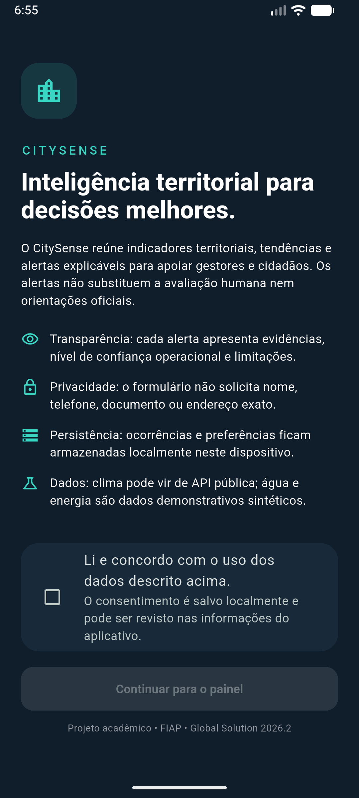
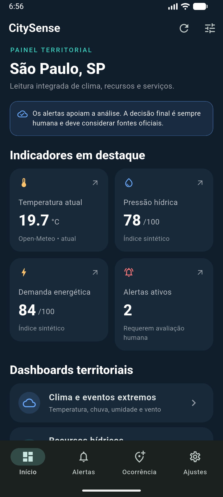
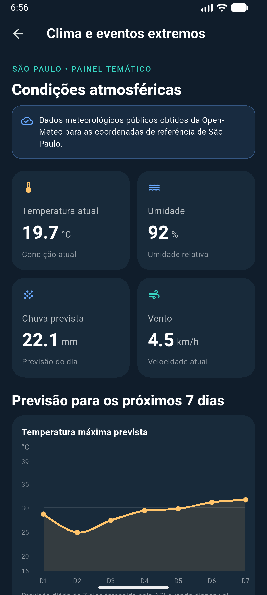
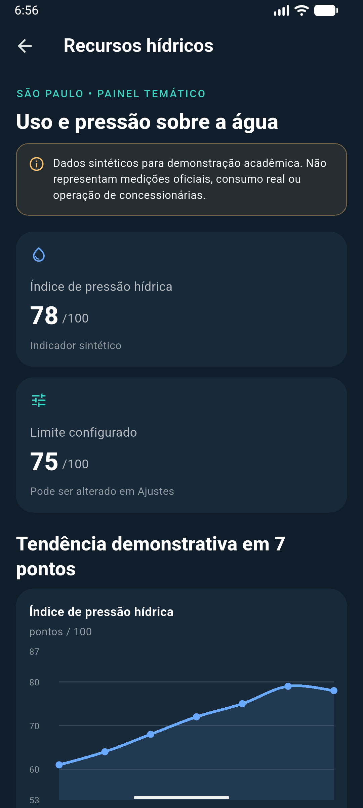
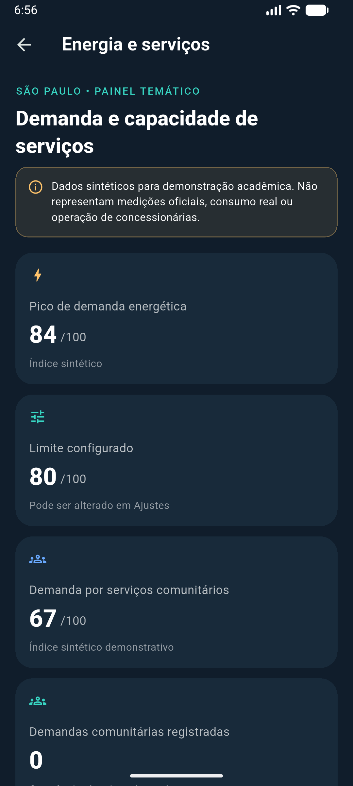
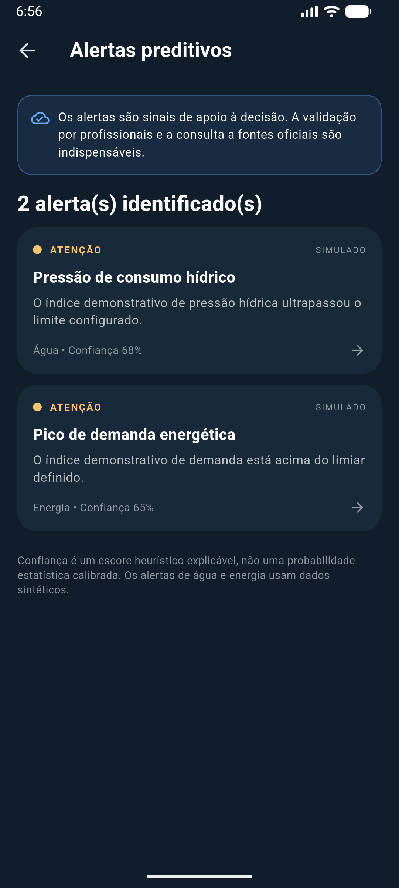
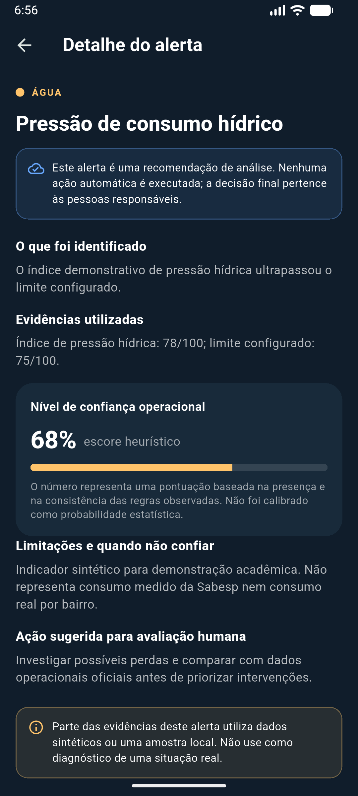
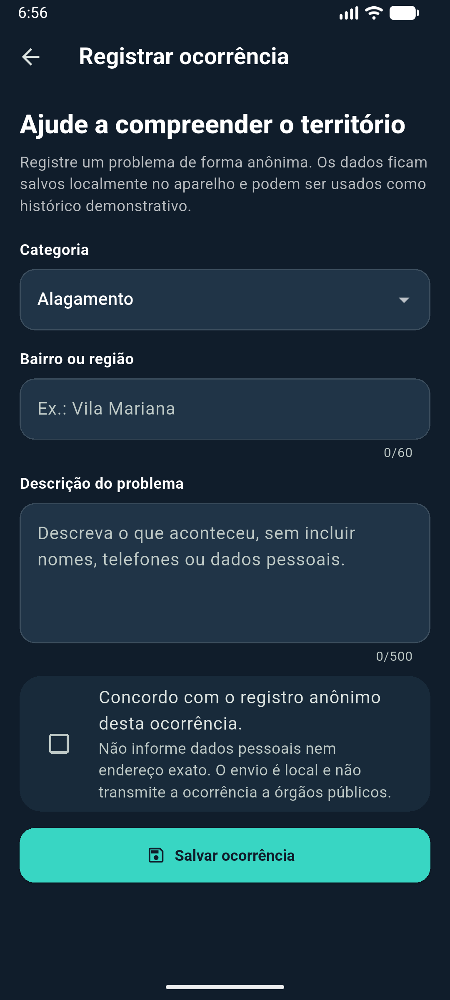
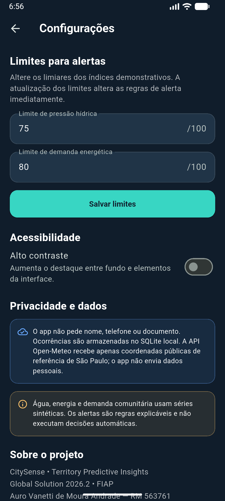

# CitySense — Inteligência Territorial

**Tecnologia para antecipar riscos locais e apoiar decisões públicas mais conscientes.**

Projeto acadêmico desenvolvido para a Global Solution 2026.2 da FIAP — disciplina Cross-Platform Application Development — desafio *Territory Predictive Insights*.

> **Status da entrega:** o código-fonte e a documentação estão preparados. Antes da submissão, ainda é necessário executar o projeto em Flutter, validar no emulador/dispositivo, capturar os prints reais de todas as telas, gravar/publicar o vídeo de até 3 minutos e preencher os links finais no arquivo `ENTREGA_FIAP.txt`. Este ambiente de criação não possui Flutter SDK nem emulador, portanto não foram gerados APK ou evidências fictícias.

## 1. Problema e público

Cidades precisam acompanhar condições ambientais e sinais de pressão sobre serviços para planejar ações preventivas. Informações fragmentadas ou analisadas apenas depois de uma ocorrência podem dificultar a priorização de recursos.

O CitySense é um painel mobile demonstrativo voltado a gestores públicos, equipes de planejamento territorial e cidadãos. A primeira área de referência é o município de São Paulo (SP). A aplicação reúne dados climáticos públicos, indicadores sintéticos de água e energia, regras transparentes de alerta e registro comunitário anônimo no dispositivo.

O impacto social esperado é melhorar a leitura de sinais territoriais e apoiar a priorização humana de análises preventivas. O aplicativo **não** comprova redução de acidentes, perdas ou consumo; seu indicador social mede sinais preventivos apresentados para revisão humana, e não resultados sociais alcançados.

## 2. Integrantes

| Integrante | RM |
|---|---:|
| Auro Vanetti de Moura Andrade | 563761 |
| Renan Mano Otero | 554911 |

## 3. Demonstração visual

### Consentimento e privacidade


### Dashboard geral


### Dashboard de clima


### Dashboard de água


### Dashboard de energia e serviços


### Lista de alertas


### Detalhe do alerta


### Registro de ocorrência


### Configurações


## 4. Funcionalidades implementadas no código

- [x] Tela inicial de consentimento e informações de privacidade.
- [x] Dashboard geral para São Paulo com cartões de indicadores e navegação.
- [x] Três dashboards temáticos distintos: clima, recursos hídricos e energia/serviços.
- [x] Gráficos de tendências com `fl_chart`.
- [x] Alertas criados por regras explícitas com evidência, severidade, escore de confiança operacional, limitações e ação recomendada.
- [x] Tela de detalhe de alerta e aviso de decisão humana.
- [x] Estado global com Provider e estado local de formulários.
- [x] Estados de carregamento, erro/offline e lista vazia.
- [x] Consumo de API externa Open-Meteo para clima e previsão de sete dias.
- [x] Cache local de clima e fallback para dados locais demonstrativos sem conexão.
- [x] Persistência SQLite de ocorrências e SharedPreferences para consentimento, tema e limites.
- [x] Formulário de ocorrência com validação de categoria, região, descrição e consentimento.
- [x] Configuração e persistência de limiares de alertas.
- [x] Tema de alto contraste.
- [x] Coleta mínima: o formulário não solicita nome, telefone, documento ou endereço exato.
- [x] Testes unitários das regras de alerta em `test/alert_engine_test.dart`.
- [x] Reexecutar `flutter test` após a correção dos erros de compilação reportados na primeira execução local e guardar o log aprovado como evidência. O teste de widget `test/widget_test.dart` foi alinhado à classe real `CitySenseApp`; a aprovação ainda precisa ser confirmada no computador da equipe.
- [x] Capturas de tela reais de todas as telas.
- [x] Teste real em dois tamanhos de tela.
- [x] APK de release.
- [x] Vídeo demonstrativo.

## 5. Dados, indicadores e geração de alertas

### Fontes de dados

| Fonte | Dados usados | Natureza | Observação |
|---|---|---|---|
| Open-Meteo Forecast API | Temperatura atual, precipitação, umidade relativa, vento e previsão diária de sete dias | Público / externo | Consulta por coordenadas de referência do município de São Paulo; requer internet para atualização. |
| Índice hídrico | Série ilustrativa de pressão hídrica | Sintético | Não representa leituras da Sabesp nem consumo real por bairro. |
| Índice energético | Série ilustrativa de demanda energética | Sintético | Não representa medidores, concessionárias ou carga da rede elétrica. |
| Demanda por serviços comunitários | Índice ilustrativo de procura por serviços | Sintético | Não representa chamados ou filas reais de serviços municipais. |
| Ocorrências registradas no app | Categoria, bairro/região, descrição e data | Informado pelo usuário | Armazenado localmente no dispositivo; não é enviado a órgão público. |

API: [Open-Meteo Forecast API](https://open-meteo.com/en/docs).

### Regras e métricas

O mecanismo é baseado em regras determinísticas, não em um modelo de machine learning treinado. Os limites iniciais são configuráveis nas Preferências:

- **Calor intenso:** dispara quando a temperatura máxima prevista é maior ou igual a 32 °C. A severidade aumenta a partir de 36 °C.
- **Chuva elevada:** dispara quando a precipitação diária prevista é maior ou igual a 40 mm. A severidade aumenta a partir de 70 mm.
- **Pressão hídrica:** índice sintético fixo de 78/100; dispara ao ultrapassar o limite configurado (inicialmente 75/100).
- **Pico energético:** índice sintético fixo de 84/100; dispara ao ultrapassar o limite configurado (inicialmente 80/100).

Cada alerta apresenta evidência, categoria, severidade, escore de confiança operacional de 0 a 100, limitações e ação sugerida. **O escore é heurístico e não é uma probabilidade estatística calibrada.** Ele não foi validado retrospectivamente nem deve ser interpretado como chance real de um evento ocorrer.

### Limitações, vieses e condições de baixa confiabilidade

- A previsão climática é agregada para uma coordenada de referência; não descreve microclimas de cada bairro ou rua.
- A previsão pode mudar e depende da disponibilidade e qualidade da fonte externa.
- Água e energia usam indicadores sintéticos para demonstrar o fluxo da aplicação; não podem embasar decisões operacionais reais.
- As ocorrências são autorrelatadas, podem ser incompletas, duplicadas ou enviesadas pela participação desigual de moradores.
- A ausência de alerta não significa ausência de risco. Eventos locais podem ocorrer mesmo sem ultrapassar os limiares.
- Alertas não devem ser usados isoladamente em decisões sobre pessoas, serviços essenciais, interdições ou alocação de recursos.
- Não há validação histórica, análise de calibração, estimativa de falsos positivos/falsos negativos ou avaliação de equidade territorial neste protótipo.

## 6. Privacidade, acessibilidade e impacto social

- A primeira abertura apresenta tela de consentimento explícito; a escolha é persistida no dispositivo.
- O formulário pede apenas categoria, bairro/região e descrição, orienta a não incluir dados pessoais e bloqueia padrões comuns de e-mail, CPF ou telefone. Essa validação reduz o risco, mas não garante anonimização de qualquer texto livre; a equipe deve revisar relatos e não inserir nomes ou endereços exatos.
- As ocorrências são mantidas em SQLite local; não existe transmissão dessas ocorrências a um servidor.
- A consulta Open-Meteo usa coordenadas públicas de referência de São Paulo, sem envio de dados pessoais.
- A interface usa contraste elevado, rótulos semânticos nos cartões, descrições em texto e controles acessíveis do Material Design.
- A configuração de alto contraste pode ser ativada na tela Configurações.
- O indicador social apresentado é o número de sinais preventivos disponíveis para avaliação humana. Ele mede atividade do sistema, não benefício comprovado ou quantidade real de pessoas protegidas.

## 7. Tecnologias e decisões técnicas

| Tecnologia | Uso e justificativa |
|---|---|
| Flutter / Dart | Aplicação mobile multiplataforma com widgets reutilizáveis. |
| Material 3 | Componentes, navegação e padrões de interação consistentes. |
| Provider | Estado global compartilhado e atualização reativa das telas. |
| Open-Meteo + `http` | Consumo de API meteorológica pública sem chave de API. |
| `sqflite` | Persistência relacional local das ocorrências. |
| `shared_preferences` | Cache de clima, consentimento, preferências e limiares simples. |
| `fl_chart` | Gráficos de tendência nos dashboards. |
| `flutter_test` | Testes unitários da lógica de alertas. |

### Organização das pastas

```text
lib/
  app.dart
  main.dart
  models/       # modelos de clima, alertas e ocorrências
  providers/    # estado global com Provider
  screens/      # consentimento, dashboards, alertas, formulário e ajustes
  services/     # API, persistência e motor de regras
  theme/        # identidade visual e alto contraste
  widgets/      # cartões, avisos, títulos e gráficos reutilizáveis
test/           # testes unitários
tool_bootstrap.ps1  # preparação da plataforma no Windows
tool_bootstrap.sh   # preparação da plataforma no macOS/Linux
assets/screenshots/  # capturas reais a adicionar antes da submissão
```

Fluxo resumido:

```text
Open-Meteo API ──> WeatherApiService ──> CitySenseProvider ──> Dashboards/Alertas
                         │                     │
                         └── falha ──> Cache local / amostra demonstrativa
                                               │
Formulário ──> Provider ──> SQLite (ocorrências)│
Configurações ──> Provider ──> SharedPreferences
```

## 8. Como executar

### Pré-requisitos

- Flutter SDK 3.35.0 ou superior instalado e configurado no PATH.
- Android Studio com Android SDK e emulador, ou dispositivo Android com depuração USB.
- Conexão à internet para buscar clima atual; sem conexão o app usa cache ou amostra demonstrativa.

### Preparação inicial

A pasta inclui `tool_bootstrap.ps1` e `tool_bootstrap.sh` na raiz do projeto. Esses scripts geram as pastas de plataforma Flutter caso não existam, garantem a permissão Android de internet e instalam dependências.

**Windows PowerShell**, dentro da pasta `citysense`:

```powershell
.\tool_bootstrap.ps1
flutter run
```

**macOS / Linux**, dentro da pasta `citysense`:

```bash
./tool_bootstrap.sh
flutter run
```

Ou manualmente:

```bash
flutter create --platforms=android,ios .
flutter pub get
flutter analyze
flutter test
flutter run
```

### Build Android

```bash
flutter build apk --release
```

O APK, caso o build seja concluído com sucesso, ficará em `build/app/outputs/flutter-apk/app-release.apk`. O arquivo não está incluído porque não foi possível executar o build neste ambiente.

### Capturas de tela

Execute cada tela no emulador, capture com o recurso de screenshot do Android Studio ou:

```bash
adb exec-out screencap -p > assets/screenshots/02-dashboard-geral.png
```

Repita para cada tela e atualize esta seção com as imagens reais. Teste ao menos dois tamanhos de tela antes da entrega.

## 9. Vídeo de demonstração

[Link público](https://youtu.be/oMcFtSJSMHc)

## 10. Licença

Projeto acadêmico da FIAP, desenvolvido para a Global Solution 2026.2 — Cross-Platform Application Development. Material destinado à avaliação educacional; dados sintéticos identificados como demonstrativos.

## 11. Aviso de uso

O CitySense é um protótipo acadêmico. Antes de qualquer uso operacional, substitua dados sintéticos por fontes autorizadas, valide o mecanismo com séries históricas, revise segurança e privacidade, e estabeleça governança humana dos alertas.
